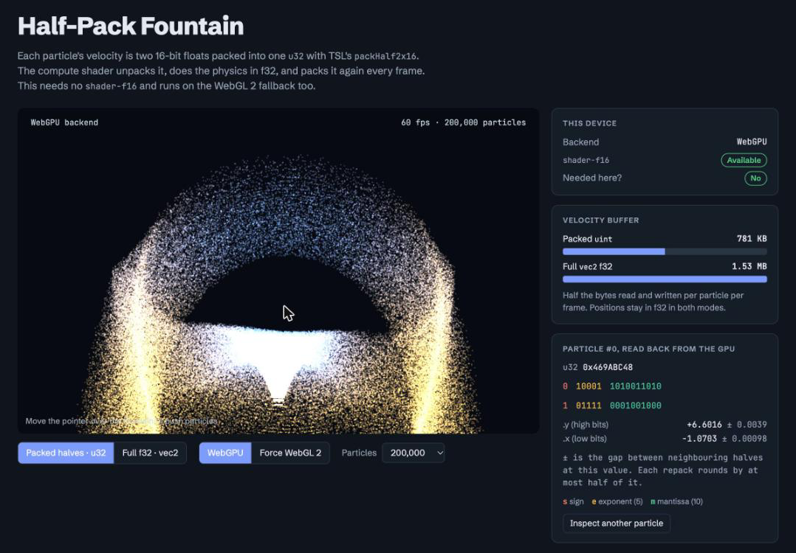

# Half-Pack Fountain

A three.js (WebGPU renderer + TSL) particle fountain that stores each particle's
2D velocity as **two 16-bit floats packed into one `u32`** using TSL's
`packHalf2x16` / `unpackHalf2x16`. The compute shader unpacks the velocity, does
the physics in f32, and packs it again every frame.

This needs **no `shader-f16`** device feature. The pack/unpack functions compile
to `pack2x16float` / `unpack2x16float` in WGSL and `packHalf2x16` /
`unpackHalf2x16` in GLSL ES 3.0, so the same code runs on the WebGPU backend and
on the WebGL 2 fallback.



## Run it

There is no build step. three.js 0.186.1 loads from cdn.jsdelivr.net, so you
need an internet connection.

Serve the folder over `localhost`, because WebGPU only runs in a secure context
and ES modules don't load reliably from `file://`. Any static server works:

```sh
git clone https://github.com/adamhunger/half-pack-fountain.git
cd half-pack-fountain
python3 -m http.server 8000
# or: npx serve .
```

Then open <http://localhost:8000> in a browser with WebGPU (Chrome or Edge 113+,
Safari 26+, Firefox 141+ on Windows). Other browsers fall back to WebGL 2.

To try it on a phone, serve on your LAN (`python3 -m http.server 8000 --bind 0.0.0.0`)
and open `http://<your-mac-ip>:8000`. Plain-HTTP LAN addresses are not secure
contexts, so the phone will use the WebGL 2 backend. For WebGPU on the phone,
serve over HTTPS (for example with a tunnel such as `cloudflared` or `ngrok`).

## What's on the page

- **Stage**: the fountain. Move the pointer (or drag a finger) over it to push particles.
- **Packed halves · u32 / Full f32 · vec2**: switches the velocity storage. Both
  buffers are kept in sync, so you can compare the two live.
- **WebGPU / Force WebGL 2**: recreates the renderer with `forceWebGL: true` to
  exercise the fallback backend.
- **Particles**: 50k to 1M. Phones start at 50k.
- **This device**: the active backend and whether `shader-f16` is available, shown
  only to make the point that this demo doesn't use it.
- **Velocity buffer**: bytes for the packed buffer vs. a `vec2<f32>` buffer.
- **Particle readout**: one particle's packed `u32` read back from the GPU,
  with each half split into sign / exponent / mantissa bits, its decoded value,
  and the spacing between neighbouring halves at that value.

## Files

| File | Contents |
|---|---|
| `index.html` | Page markup, plus a small inline script that shows load and runtime errors on the stage |
| `style.css` | Light and dark themes via CSS custom properties |
| `main.js` | Renderer setup, TSL compute shaders, materials, GPU readback, UI wiring |
| `docs/screenshot.png` | The screenshot above |

## How the packing works (`main.js`)

```js
const velPacked = instancedArray( count, 'uint' );      // two halves per element

const update = Fn( () => {
  const vel = unpackHalf2x16( velPacked.element( instanceIndex ) ).toVar();  // vec2, f32 math
  // … gravity, pointer push, damping, move, respawn …
  velPacked.element( instanceIndex ).assign( packHalf2x16( vel ) );          // back to 16 + 16 bits
} )().compute( count );
```

- `.x` goes in the low 16 bits and `.y` in the high 16 bits.
- Positions stay in a full-precision `vec3` buffer. A half tops out at ±65504 with
  about 3 significant digits, which is fine for velocities but not for world positions.
- Each repack rounds again. A slowly integrated value can drift, so keep it in f32
  if that matters.
- The readout doesn't pull the whole buffer back. A one-thread compute pass copies
  the inspected particle into a 1-element buffer, and only that buffer is read with
  `renderer.getArrayBufferAsync`.

To pin a different three.js version, change the import URL at the top of `main.js`.
`packHalf2x16` / `unpackHalf2x16` first shipped in r182 (0.182.0).

## Status

Verified in Chrome on macOS, on the WebGPU backend: the scene renders and the GPU
readback decodes correctly. Not yet verified by hand: the storage-mode, backend and
count controls, the WebGL 2 path, and real-world frame rates.

## License

[MIT](LICENSE). three.js, loaded from the CDN, is also MIT. The Schibsted Grotesk
and JetBrains Mono fonts load from Google Fonts under the SIL Open Font License
and aren't included in this repo.
